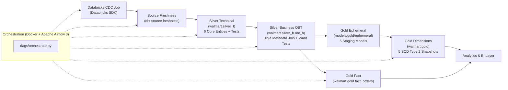

# Walmart Retail ELT Pipeline (Apache Airflow 3 + dbt + Databricks)

An end-to-end, containerized data engineering pipeline that orchestrates Change Data Capture (CDC) ingestion and multi-layered data transformations for Walmart retail data using **Apache Airflow 3**, **dbt Core (`dbt-databricks`)**, **Databricks Unity Catalog**, and **Docker**.

The project implements a **Medallion & Star Schema Architecture**—triggering upstream Databricks ingestion jobs, verifying source freshness, building cleaned Silver entity tables, generating a metadata-driven **One Big Table (OBT)** via Jinja, and maintaining historical **SCD Type 2** dimensions alongside a Gold fact table.

## Architecture Overview



### Key Engineering Highlights

* **Hybrid Airflow + Databricks Orchestration:** Uses the Airflow 3 Task SDK (`@dag`, `@task`) and `databricks-sdk` (`WorkspaceClient`) to trigger an upstream Databricks CDC workflow, asynchronously poll run states with timeout handling, and sequence downstream dbt execution.
* **Unity Catalog Medallion Architecture:** Organizes tables cleanly inside the `walmart` Unity Catalog across `silver_t` (technical entity layer), `silver_b` (business OBT layer), and `gold` (dimensional Star Schema).
* **Metadata-Driven Jinja Modeling:** The Silver OBT (`obt_b.sql`) uses a declarative Jinja configuration array to dynamically compile column aliases and `LEFT JOIN` relationships across five normalized retail tables.
* **SCD Type 2 Historical Tracking:** Combines `ephemeral` staging models with `dbt snapshot` (`strategy: timestamp`) to track historical dimension changes with open-ended validity dates (`9999-12-31`).
* **Tiered Data Quality Gates:** Enforces `dbt source freshness` prior to transformation, blocking schema tests on `silver_t`, and non-blocking `warn`-severity referential integrity checks on `obt_b`.

## Tech Stack

| Component | Technology |
| :--- | :--- |
| **Orchestration** | Apache Airflow `>=3.4.0` (Airflow Task SDK & `BashOperator`) |
| **Cloud Data Platform** | Databricks SQL Warehouse & Unity Catalog (`walmart`) |
| **Databricks Integration** | `databricks-sdk >=0.47.0` (`WorkspaceClient` Jobs API) |
| **Data Transformation** | dbt Core `1.12.7` & `dbt-databricks 1.10.9` |
| **Containerization** | Docker & Docker Compose |
| **Languages** | Python, SQL, Jinja, YAML |

## Project Structure

```text
airflow_dbt_project/
├── dags/
│   └── orchestrate.py                 # Airflow 3 DAG orchestrating CDC ingestion & dbt layers
├── walmart_dbt_project/
│   ├── analyses/                      # Ad-hoc exploratory SQL queries
│   ├── macros/
│   │   └── custom_schema.sql          # Custom schema resolution macro
│   ├── models/
│   │   ├── source/
│   │   │   └── sources.yml            # Raw source definitions & freshness configs
│   │   ├── silver_t/                  # Cleaned & standardized entity tables (walmart.silver_t)
│   │   │   ├── customers_t.sql
│   │   │   ├── employees_t.sql
│   │   │   ├── order_items_t.sql
│   │   │   ├── orders_t.sql
│   │   │   ├── products_t.sql
│   │   │   ├── stores_t.sql
│   │   │   └── properties.yml         # Column documentation & blocking dbt tests
│   │   ├── silver_b/                  # Business / Denormalized Silver layer (walmart.silver_b)
│   │   │   └── obt_b.sql              # Jinja-driven One Big Table (OBT)
│   │   └── gold/                      # Star Schema layer (walmart.gold)
│   │       ├── ephemeral/             # Non-materialized prep models for snapshots
│   │       │   ├── eph_customers.sql
│   │       │   ├── eph_employees.sql
│   │       │   ├── eph_orders.sql
│   │       │   ├── eph_products.sql
│   │       │   └── eph_stores.sql
│   │       └── fact/
│   │           └── fact_orders.sql    # Core transactional orders fact table
│   ├── snapshots/                     # SCD Type 2 dimension snapshots (walmart.gold)
│   │   ├── dim_customers.yml
│   │   ├── dim_employees.yml
│   │   ├── dim_orders.yml
│   │   ├── dim_products.yml
│   │   └── dim_stores.yml
│   ├── tests/
│   │   └── test_obt_b.sql             # Singular data quality test (severity: warn)
│   ├── dbt_project.yml                # dbt project & materialization configurations
│   ├── packages.yml                   # dbt package dependencies
│   └── profiles.yml.example           # Databricks warehouse connection template
├── .env.example                       # Environment variable template
├── Dockerfile                         # Custom Airflow + dbt image definition
├── docker-compose.yaml                # Multi-container Airflow service stack
└── requirements.txt                   # Python dependencies
```

## Data Modeling & Pipeline Layers

### 1. CDC Ingestion & Source Freshness
* **Databricks CDC Job (`ingest_cdc`)**: Triggers a Databricks job via `WorkspaceClient().jobs.run_now(...)` and polls every 5 seconds (up to a 55-minute polling timeout / 1-hour task execution timeout) until the run reaches `TERMINATED` with `SUCCESS`.
* **Freshness Check (`dbt source freshness`)**: Verifies upstream source latency before executing transformations.

### 2. Silver Technical Layer (`walmart.silver_t`)
Materialized as Delta tables (`+materialized: table`), standardizing six core domain entities with CDC audit metadata (`created_timestamp`, `updated_timestamp`, `is_active`, `processed_at`):
* `customers_t`
* `employees_t`
* `orders_t`
* `order_items_t`
* `products_t`
* `stores_t`

### 3. Silver Business Layer – One Big Table (`walmart.silver_b.obt_b`)
Materialized as a Delta table (`+materialized: table`), `obt_b.sql` uses a **metadata-driven Jinja loop** (``) to dynamically select, alias, and `LEFT JOIN` `orders_t`, `customers_t`, `order_items_t`, `products_t`, and `stores_t` into a single denormalized analytical table stamped with `obt_b_processed_at`.

### 4. Gold Star Schema Layer (`walmart.gold`)
* **Ephemeral Models (`models/gold/ephemeral/`)**: Configured with `+materialized: ephemeral` to stage clean dimension attributes (`eph_customers`, `eph_employees`, `eph_orders`, `eph_products`, `eph_stores`) without persisting intermediate tables in Unity Catalog.
* **SCD Type 2 Dimensions (`snapshots/`)**: Builds `dim_customers`, `dim_employees`, `dim_orders`, `dim_products`, and `dim_stores` in `walmart.gold` using `strategy: timestamp` against each entity's `*_updated_timestamp` column and setting active records to `dbt_valid_to_current: "to_date('9999-12-31')"`.
* **Fact Table (`models/gold/fact/fact_orders.sql`)**: Materialized as a Gold table capturing order-level metrics and foreign keys to the dimension tables.

## Orchestration Flow (`dags/orchestrate.py`)

The `orchestrate` DAG enforces strict sequential quality gates across 10 tasks:

```text
ingest_cdc
  └──▶ clean_target
         └──▶ source_freshness
                └──▶ silver_technical (dbt run --select silver_t)
                       └──▶ silver_technical_tests (dbt test --select silver_t)
                              └──▶ silver_business (dbt run --select silver_b)
                                     └──▶ silver_business_tests (dbt test --select silver_b)
                                            └──▶ gold_ephemeral (dbt run --select gold/ephemeral)
                                                   └──▶ gold_dimensions (dbt snapshot)
                                                          └──▶ gold_facts (dbt run --select gold/fact)
```

## Data Quality & Testing

* **Source Freshness (`dbt source freshness`):** Validates that raw landing tables meet expected SLA windows before model runs begin.
* **Silver Technical Tests (`models/silver_t/properties.yml`):** Blocking schema tests validating primary keys and core entity constraints before `obt_b` is built.
* **Silver OBT Singular Test (`tests/test_obt_b.sql`):** Configured with `{{ config(severity = 'warn') }}` to detect missing joins or null keys (`order_id`, `customer_id`, `order_item_id`, `product_id`, `store_id`) in `obt_b` while allowing downstream Gold builds to proceed with alerts.

## Getting Started

### Prerequisites

* [Docker](https://www.docker.com/get-started) & Docker Compose
* A Databricks Workspace with Unity Catalog enabled (`walmart` catalog) and an active SQL Warehouse

### 1. Clone the Repository

```bash
git clone https://github.com/<your-username>/Airflow_dbt_Data_Engineering_Project.git
cd Airflow_dbt_Data_Engineering_Project/airflow_dbt_project
```

### 2. Configure Environment Variables

Copy `.env.example` to `.env` and populate your Databricks and Airflow 3 secrets:

```bash
cp .env.example .env
```

Required variables in `.env`:

| Variable | Description |
| :--- | :--- |
| `DATABRICKS_HOST` | Databricks workspace URL (`https://<your-workspace-host>`) |
| `DATABRICKS_TOKEN` | Databricks Personal Access Token (PAT) or Service Principal token |
| `DATABRICKS_HTTP_PATH` | SQL Warehouse HTTP path (`/sql/1.0/warehouses/<warehouse-id>`) |
| `FERNET_KEY` | Fernet encryption key for Airflow connections/variables |
| `AIRFLOW__API_AUTH__JWT_SECRET` | Random secret key for Airflow 3 API authentication |
| `AIRFLOW__API_AUTH__JWT_ISSUER` | JWT issuer identifier (default: `airflow`) |
| `AIRFLOW_UID` | Host user ID for container volume permissions (default: `50000`) |
| `AIRFLOW_WEBSERVER_PORT` | Local port exposed for the Airflow UI (default: `8080`) |

### 3. Configure dbt Profile

Copy the example dbt profile to `profiles.yml` (it automatically reads `DATABRICKS_HOST`, `DATABRICKS_TOKEN`, and `DATABRICKS_HTTP_PATH` from your environment):

```bash
cp walmart_dbt_project/profiles.yml.example walmart_dbt_project/profiles.yml
```

### 4. Build and Start the Containers

```bash
docker compose up --build -d
```

### 5. Trigger the Pipeline

1. Open the Airflow UI at `http://localhost:8080`.
2. Unpause and trigger the **`orchestrate`** DAG.
3. Monitor task logs as Airflow triggers the Databricks CDC job and executes each dbt layer into the `walmart` catalog.

## Useful dbt Commands

To run or debug dbt commands manually inside the Airflow container:

```bash
# Enter the dbt project directory inside the container
docker compose exec airflow-apiserver bash -c "cd /opt/airflow/walmart_dbt_project && dbt debug"

# Install dbt packages
dbt deps

# Run a specific Medallion layer
dbt run --select silver_t
dbt run --select silver_b
dbt run --select gold/fact

# Build SCD Type 2 dimension snapshots
dbt snapshot

# Execute all data quality tests
dbt test

# Generate and serve dbt lineage docs
dbt docs generate && dbt docs serve
```

## Future Improvements

* **CI/CD Automation:** Add GitHub Actions workflows for SQL linting (`sqlfluff`), `dbt parse`, and slim CI testing on pull requests.
* **Granular Task Visibility:** Integrate [Astronomer Cosmos](https://github.com/astronomer/astronomer-cosmos) to surface individual dbt models and tests as native Airflow tasks.
* **BI Integration:** Connect Databricks AI/BI Dashboards, Power BI, or Tableau directly to `walmart.gold` (`fact_orders` and `dim_*` views).

## License

This project is open-source and available under the [MIT License](LICENSE).